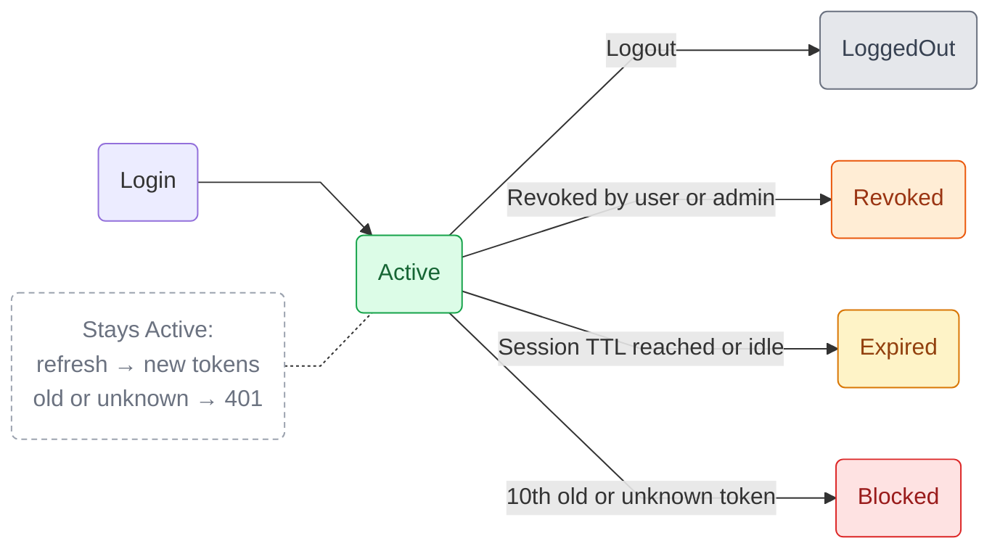

import { Callout } from 'nextra/components';

# Sessions

Every login opens an **auth session** on the engine. Sessions let users stay logged in for weeks while the tokens they send stay short-lived, and they can be ended from the server at any time.

## Session and tokens

| | Lifetime (default) | Configured by | Purpose |
|---|---|---|---|
| **Session** | 30 days | `auth.config.sessionTtl` (days) | Absolute limit. After it, the user logs in again. Refreshing doesn't extend it. |
| **Access token** | 15 minutes | `auth.config.accessTtl` (minutes) | Sent on every request (`Authorization: Bearer …` or `bsh_access_token` cookie). |
| **Refresh token** | 7 days | `auth.config.refreshTtl` (days) | Used to get new tokens for the same session (`X-BSH-REFRESHTOKEN` header or `bsh_refresh_token` cookie). |

Both tokens only carry the user id (`sub`), the session id (`sid`) and a token id (`jti`). Use [GET /api/users/me](/docs/bsh-engine/api/users/get-current-user) to fetch user details.

<Callout>
  Token expiry is based on the TTLs currently configured, so changing `accessTtl` or `refreshTtl` also applies to tokens already issued.
</Callout>

## Lifecycle



| Status | When |
|--------|------|
| `Active` | The session can be used and refreshed. |
| `LoggedOut` | The user called [Logout](/docs/bsh-engine/api/authentication/logout) with this session. |
| `Revoked` | The session was [revoked](/docs/bsh-engine/api/sessions/revoke) from another session, or by a `BSH_ADMIN`. |
| `Expired` | The session reached `sessionTtl`, or was [idle](#session-and-tokens) for longer than `refreshTtl`. |
| `Blocked` | Rotated or unknown tokens of this session were used too many times, a sign the tokens were stolen. See [Token rotation](#token-rotation). |

<Callout>
    When the engine closes a session itself, it records why in the session's `reason` field.
</Callout>

## Token rotation

Each refresh, automatic or through [`POST /api/auth/refresh`](/docs/bsh-engine/api/authentication/refresh-token), issues a **new access token and a new refresh token** for the same session.

- The previous refresh token keeps working for **10 seconds**, so requests sent in parallel don't fail.
- After that, using it again is treated as a stolen token: the whole session is closed as `Expired`.

<Callout type="warning">
  Clients that store tokens themselves must save **both** new tokens after each refresh. Keeping the old refresh token logs the user out on the next refresh. Cookie sessions are updated by the engine automatically. With the SDK, use [`onTokenRefreshed`](/docs/bsh-engine/sdk/authentication/auto-refresh).
</Callout>

## Device details

At login, the engine records which device and app the session belongs to, so users can recognize their sessions. It's returned as the `metadata` object on every [session](/docs/bsh-engine/api/sessions#session-object):

```json
"metadata": {
  "label": "Chrome 131 on Android",
  "browser": "Chrome",
  "browserVersion": "131",
  "os": "Android",
  "device": "Mobile",
  "client": "My App",
  "userAgent": "Mozilla/5.0 (Linux; Android 14; Pixel 8) AppleWebKit/537.36 (KHTML, like Gecko) Chrome/131.0.0.0 Mobile Safari/537.36"
}
```

| Field | Source | Description |
|-------|--------|-------------|
| `label` | `User-Agent` | Readable summary, for example `Chrome 131 on Android`. |
| `browser` | `User-Agent` | Browser or HTTP client |
| `browserVersion` | `User-Agent` | Major version for browsers, full version for HTTP clients. |
| `os` | `User-Agent` | Operating system, see the values below. |
| `device` | `User-Agent` | `Desktop`, `Mobile`, `Tablet` or `Other` (non-browser clients). |
| `client` | `X-Bsh-Client` | Name of the app that logged in [`clientName`](/docs/bsh-engine/sdk/configuration). |
| `userAgent` | `User-Agent` | The raw header, cut to 512 characters. |

| Field | Possible values |
|-------|-----------------|
| `browser` | `Edge`, `Opera`, `Samsung Internet`, `Firefox`, `Chrome`, `Safari`, `Postman`, `curl`, `axios`, `node-fetch`, `Java`, `Python` |
| `os` | `Windows`, `iOS`, `Android`, `ChromeOS`, `macOS`, `Linux` |
| `device` | `Desktop`, `Mobile`, `Tablet`, `Other` |

The SDK exports these lists as [`BshSessionMetaData`](/docs/bsh-engine/sdk/services/auth-sessions#session-metadata).

<Callout type="info">
  The client IP address is **not** stored with the session.
</Callout>

## Managing sessions

### From the dashboard

`BSH_ADMIN` users see the sessions of every user under **Security → Auth Sessions**, with the device, owner, status and dates of each session. Active sessions can be revoked from the actions column, except the one you are using.


Every user can manage their own sessions from their **Profile**. The session in use is pinned at the top as **This device**. Other active sessions can be revoked one by one, or all at once with **Sign out other sessions**.


### From the API or the SDK

- [Auth Sessions API](/docs/bsh-engine/api/sessions): list, inspect, count and revoke sessions.
- [Auth Sessions Service](/docs/bsh-engine/sdk/services/auth-sessions): the same operations from the SDK.
- [Logout](/docs/bsh-engine/api/authentication/logout): ends the current session.
