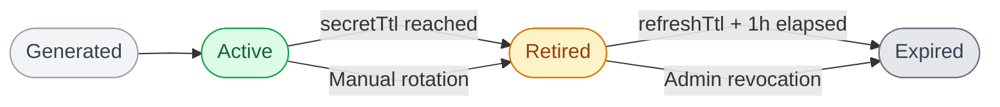

# Signing Keys

The engine signs every access and refresh token with a **JWT signing key**. Keys are generated by the engine, stored encrypted in the database and rotated automatically.

## How keys work

- On first startup, the engine generates a key and stores it.
- Each key has its own `kid` and holds **two** key pairs: one signs access tokens, the other signs refresh tokens.
- Each pair: the private key signs, the public key verifies. Tokens using any other algorithm, including `none`, are rejected.
- Every token carries the `kid` of the key that signed it, in its header.
- The engine checks the token with that key. A token with a missing or unknown `kid` is rejected.
- The public keys that verify access tokens are published at [`/.well-known/jwks.json`](#verifying-tokens-in-other-services), so other services can verify access tokens without calling the engine.

## Encryption at rest

The private keys are encrypted before they are stored, using a key derived from [`auth.masterKey`](/docs/bsh-engine/environment/compoenents#auth). The master key is **required**.

<Callout type="warning">
  Keep `auth.masterKey` stable and identical on every instance. If it changes, the engine will create new Signing Keys and all users will logout.
</Callout>

## Lifecycle



| Status | Signs new tokens | Verifies tokens | When |
|--------|------------------|-----------------|------|
| `Active` | yes | yes | The current key. There is exactly one. |
| `Retired` | no | yes | It keeps verifying tokens it signed until `retiredAt + refreshTtl + 1h`, so users stay logged in through a rotation. |
| `Expired` | no | no | Never used again. Tokens it signed are rejected and their users have to log in again. |

## Automatic rotation

The active key is replaced after [`auth.config.secretTtl`](/docs/bsh-engine/environment/compoenents#auth) days (`30` by default). The new key signs all new tokens and the previous one becomes `Retired`.

Like the token TTLs, the rotation and grace dates follow the configuration currently set, so changing `secretTtl` or `refreshTtl` also applies to existing keys.

<Callout type="info">
  Keep `secretTtl` at least as long as `refreshTtl`. With a shorter `secretTtl`, more than two keys are alive at the same time.
</Callout>

## Manual and Emergency rotation

A `BSH_ADMIN` can rotate the key at any time, this will be useful when tokens where leaked:

| Option | Previous keys | Effect on users | Use it when |
|--------|---------------|-----------------|-------------|
| `none`: Keep previous keys valid | Stay `Retired` | None. Sessions keep working until their tokens expire. | Routine rotation |
| `previous`: Expire the previous key | The key that was active becomes `Expired` | Everyone holding tokens signed by that key is logged out. | The current key leaked |
| `all`: Expire all previous keys | Every retired key becomes `Expired` | Everyone is logged out. | You don't know which key leaked |

## Verifying tokens in other services

The engine publishes the public keys of its access tokens as a standard **JSON Web Key Set** (JWKS), with public access:

```bash
GET /.well-known/jwks.json
```

```json
{
  "keys": [
    {
      "kty": "EC",
      "crv": "P-256",
      "x": "h7I0BWOoM31TIzIHRKgU4kzKGMSWofcwz1KU3_Az2as",
      "y": "Owiaoq-WMdzojUajSxx4Z1ZgW6snsgbUZ_9uN5CRd3c",
      "kid": "a82791af-3c4d-4e5f-8a9b-0c1d2e3f4a5b",
      "alg": "ES256",
      "use": "sig",
      "key_ops": ["verify"]
    }
  ]
}
```

- Only **public access token** keys are published. Refresh tokens are only read by the engine.
- Any standard JWT library can use it: give it the URL, it picks the key matching the token's `kid`.

```typescript
import { createRemoteJWKSet, jwtVerify } from 'jose';

const jwks = createRemoteJWKSet(new URL('https://<engine-host>/.well-known/jwks.json'));

const { payload } = await jwtVerify(accessToken, jwks, { algorithms: ['ES256'] });
```

<Callout type="info">
  The response is cached for 5 minutes (`Cache-Control: max-age=300`). After a rotation, new tokens carry a `kid` that is not in a cached set yet: JWT libraries fetch the set again when they meet an unknown `kid`, as `jose` does.
</Callout>

<Callout type="warning">
  A valid signature only proves the engine issued the token. It does not tell whether the session was revoked or the user logged out since. For those checks, call the engine (for example [Get Current User](/docs/bsh-engine/api/users/get-current-user)).
</Callout>

See [JWKS](/docs/bsh-engine/api/signing-keys/jwks) in the API reference and [`bshEngine.jwks()`](/docs/bsh-engine/sdk/services/jwks) in the SDK.

## Managing keys

`BSH_ADMIN` users manage keys under **Security → Signing Keys**. The list shows each key's status, how it became active (`Scheduled` or `Manual`), when it was activated and retired, how long it stays valid and who rotated it. The key that signed your own session is tagged **Current**.


**Rotate now** opens the rotation dialog with the three options above. The reason is optional for a routine rotation and required when expiring keys.


Retired keys have an **Expire** action that ends them immediately. A reason is required.


<Callout>
Same operations from the API/SDK:
    - [Signing Keys API](/docs/bsh-engine/api/signing-keys): list, rotate and expire keys.
    - [Signing Keys Service](/docs/bsh-engine/sdk/services/signing-keys): the same operations from the SDK.
    - [JWKS](/docs/bsh-engine/api/signing-keys/jwks): the public keys that verify access tokens.
</Callout>